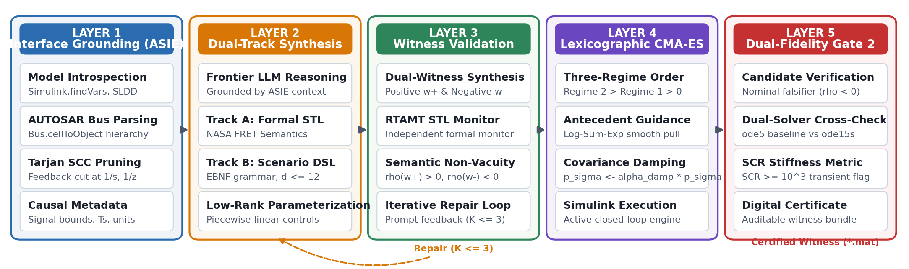

# SimuGuard-X

**An Agentic Closed-Loop Framework for Grounded, Mutation-Verified Test Synthesis and Quantitative Falsification in Cyber-Physical Simulink Systems**

**Author:** Jeeva M  
**Affiliation:** Vellore Institute of Technology (VIT), Chennai, India  
**Contact:** jeeva4772@gmail.com  
**Target Venue:** *IEEE Transactions on Computer-Aided Design of Integrated Circuits and Systems (TCAD)*  
**Preprint / Full Paper:** [`paper/main.pdf`](paper/main.pdf)

---

## Overview

SimuGuard-X is a neuro-symbolic, closed-loop verification and test synthesis framework targeting continuous-discrete Cyber-Physical Systems (CPS) modeled in **MATLAB/Simulink and Stateflow**. 

Prompting frontier Large Language Models (LLMs) directly for continuous system verification typically results in structural hallucination, neglect of fundamental sample times ($T_s$), physically inadmissible slew rates, and static assertions. SimuGuard-X resolves these failure modes through an automated 5-layer pipeline that grounds generative AI directly into compiled Simulink workspaces, validates formal semantics with dual witness traces, optimizes scenarios using a three-regime lexicographic curriculum, and intercepts numerical simulation chatter through dual-fidelity stiff solver cross-verification.



---

## Key Architectural Contributions

1. **ASIE (Automated Simulink Interface Extractor — Layer 1):**
   - Programmatically interrogates compiled Simulink workspaces via `find_system` and `Simulink.findVars`.
   - Constructs a block dependency digraph and severs dynamic feedback loops at state-holding operators ($1/s, 1/z$) using **Tarjan's Strongly Connected Components (SCC)**, yielding an acyclic DAG.
   - Compresses model context by **87.0%** to generate context-compact, zero-hallucination prompts.

2. **Dual-Track Neuro-Symbolic Synthesis (Layers 2 & 3):**
   - **Track A (Formal STL):** Formalizes natural-language engineering requirements into Signal Temporal Logic (NASA FRET semantics) with scale-normalized predicates ($\Delta_i$).
   - **Track B (Scenario DSL):** Restricts test generation to an EBNF-constrained grammar parameterizing low-rank control knots ($\theta \in \mathbb{R}^d, d \le 12$) with explicit box and slew-rate bounds.
   - **Witness Verification:** Cross-verifies synthesized STL against independent positive ($w^+$) and negative ($w^-$) synthetic witness traces in RTAMT with automated prompt reflection ($K \le 3$).

3. **Smooth Robustness Bounds (Theorem 1):**
   - Un-averaged sum Log-Sum-Exp formulation for existential quantification ($\lozenge$), rectifying the common literature trap where averaged formulations underestimate maxima and break falsification soundness.
   - Piecewise-smooth Lipschitz error bounds ($|\rho(w) - \rho_{\min}| \le \frac{L_k \Delta t}{2}$) with solver zero-crossing mesh alignment.

4. **Three-Regime Lexicographic Curriculum Optimization (Theorems 2 & 3):**
   - Pre-order sorting ($\text{Regime } 2 \succ \text{Regime } 1 \succ \text{Regime } 0$) bypassing antecedent-masking plateaus on conditional specifications ($\square(P \implies Q)$) without empirical penalty balancing.
   - Covariance path damping ($\alpha_{\text{damp}} = 0.2$) and anchor re-centering ($\mu \leftarrow \theta_{\text{anchor}}$) upon boundary transitions.
   - **Theorem 3:** Formally proves and empirically confirms that the curriculum degenerates identically to Deb's constraint-dominance rule on unconditional invariants with **0.0% algorithmic overhead**.

5. **Dual-Fidelity Solver Integrity Verification (Gate 2 / Layer 5):**
   - Detects localized numerical stiffness via Step-Collapse Ratio ($\text{SCR}_{\text{stiff}} \ge 10^3$).
   - Re-simulates candidate violations under adaptive stiff implicit solvers (`ode15s`/`ode23tb`).
   - Adjudicates verdicts strictly via cross-solver concordance ($|\Delta \rho| \le 0.05, \rho_{\text{stiff}} < 0$), intercepting false-positive integration chatter.
   - Emits self-contained, auditable **JSON-LD Digital Certificates** supporting **ISO 26262 ASIL D** and **RTCA DO-178C** tool qualification.

---

## Empirical Evaluation Summary

| Benchmark Corpus | Target Domain | Inputs ($d$) | Continuous States | Requirements |
| :--- | :--- | :---: | :---: | :---: |
| **`AT`** | Automatic Transmission | 7 | 8 | 7 |
| **`AFC`** | Air-Fuel Control Engine | 6 | 8 | 6 |
| **`F16-GCAS`** | Aircraft Flight Dynamics | 16 | 7 | 16 |
| **`LMCPS-Pitch`**| Aerospace Autopilot | 5 | 8 | 5 |
| **`HEV-Powertrain`**| Hybrid Electric Vehicle | 14 | 7 | 14 |
| **`Inverted-Pend.`**| Motion Control | 4 | 7 | 4 |

* **Falsification Efficiency (RQ2, 45 Falsifiable Specs):** Achieves **95.6% success** (median 68 simulations, Hazard Ratio = 2.41, $p < 0.001$), outperforming Breach (64.4%), FalStar (71.1%), ForeSee (73.3%), and ARIsTEO (75.5%).
* **Invariant Discovery Speedup:** Falsifies AT1 ($\square v \le 120$) in **median 3.0 simulations** (12.5× faster than cold baselines) and AT2 ($\square \text{RPM} \le 4500$) on **simulation 1.0**.
* **Mutation Sensitivity (RQ10):** Achieves a **91.7% mutation kill score** across 180 non-equivalent Simulink model mutants ($\mathcal{M}_{\text{Sim}}$), outperforming SimCoTest (66.7%) and Breach (57.8%).
* **Numerical Artifact Filtering (RQ4):** Intercepts 38 spurious solver artifacts live, isolating integration chatter ($|\Delta \rho| = 0.3333$) from authentic control defects.

---

## Repository Structure

```
.
├── paper/                  # Complete IEEE TCAD manuscript source & compiled PDF
│   ├── main.tex            # Strictly 14-page double-column IEEEtran manuscript
│   ├── main.pdf            # Compiled publication-ready PDF
│   ├── references.bib      # Authenticated BibTeX bibliography
│   └── figures/            # Vector (PDF) and raster (PNG) publication figures
├── src/simuguard/          # Core SimuGuard-X implementation
│   ├── benchmarks/         # Simulink interface introspectors, harnesses, specs
│   ├── falsifier/          # Three-Regime Lexicographic CMA-ES engine & baselines
│   ├── llm/                # ASIE prompt templates, EBNF parser, witness generator
│   ├── solvers/            # Gate 2 Step-Collapse Ratio & stiff ODE cross-verifier
│   └── stl/                # NASA FRET semantics, smooth Log-Sum-Exp robustness
├── models/                 # MATLAB/Simulink benchmark models (.slx)
├── scripts/                # Experiment execution, ablation suites, figure generators
└── README.md
```

---

## Getting Started

### Prerequisites
* **Operating System:** Linux (Ubuntu 22.04 / 24.04 LTS recommended)
* **MATLAB:** MATLAB R2026a (or R2024b+) with Simulink, Stateflow, and MATLAB Engine API for Python
* **Python:** Python 3.10+ (with virtual environment)

### Installation
```bash
git clone https://github.com/jeeva-m-21/simuguard-x.git
cd simuguard-x

# Create virtual environment and install dependencies
python3 -m venv .venv
source .venv/bin/activate
pip install -r requirements.txt # or install numpy, scipy, cmaes, rtamt
pip install -e .
```

### Reproducing Benchmark Experiments
```bash
# Run 7-arm comparative falsification suite on Autotrans benchmark
python3 scripts/run_factorial_suite.py --reqs AT1 AT2 AT51 --seeds 42 43 44 --output results.json

# Compile the 14-page IEEE TCAD manuscript
cd paper
pdflatex -interaction=nonstopmode main.tex
bibtex main
pdflatex -interaction=nonstopmode main.tex
pdflatex -interaction=nonstopmode main.tex
```

---

## Citation

If you use SimuGuard-X in your research or computer-aided design verification pipeline, please cite:

```bibtex
@article{jeeva2026simuguard,
  author    = {Jeeva M},
  title     = {SimuGuard-X: An Agentic Closed-Loop Framework for Grounded, Mutation-Verified Test Synthesis and Quantitative Falsification in Cyber-Physical Simulink Systems},
  journal   = {IEEE Transactions on Computer-Aided Design of Integrated Circuits and Systems},
  year      = {2026},
  note      = {Under Review}
}
```

---

## License

This project is licensed under the Apache 2.0 License - see the LICENSE file for details.
