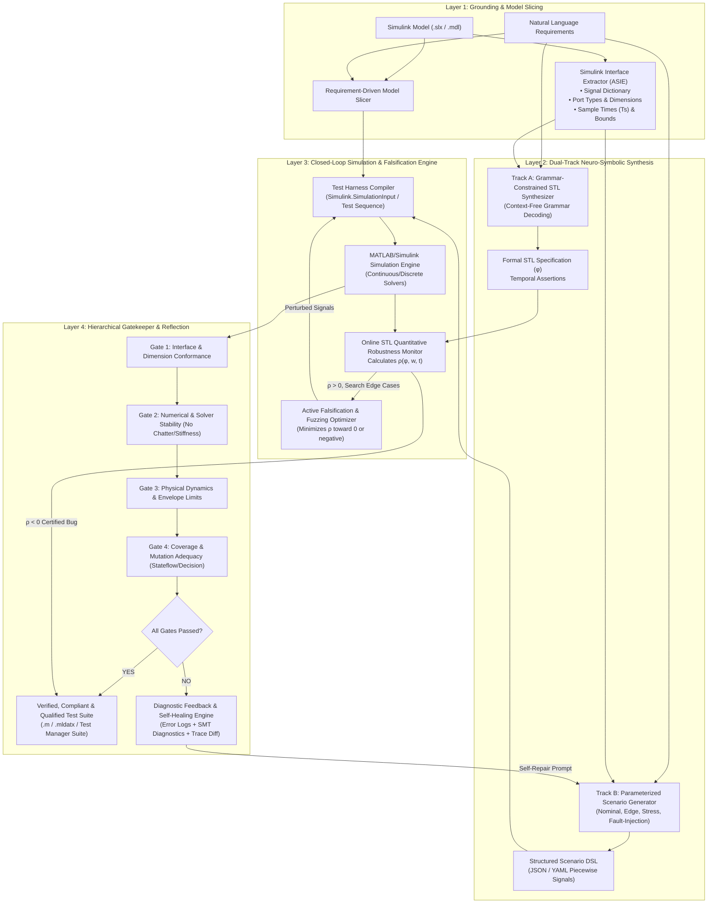

# Novel Architecture Specification: SimuGuard-X

## A Neuro-Symbolic Closed-Loop Architecture for Generating, Grounding, and Verifying Tests for MATLAB/Simulink Cyber-Physical Systems

---

## 1. Architectural Motivation & Problem Formulation

In Cyber-Physical Systems (CPS) engineered with MATLAB/Simulink, traditional testing workflows face a severe triple penalty:
1. **The Semantic-Syntax Gap:** Engineers write informal requirements in text, while Simulink requires precise time-series signal arrays, sample time synchronization, and multi-domain physical parameters.
2. **The LLM Hallucination & Physical Disconnect Penalty:** Unassisted LLMs hallucinate Simulink block paths, ignore sample times, violate conservation laws, and achieve an engineering qualification rate below 25% (SimuVerity, Oct 2026).
3. **The Static Assertion Limitation:** Scalar unit tests (`assert x == y`) cannot evaluate continuous physical dynamics such as overshoot, settling time, resonant frequency, or time-bounded state transitions.

**SimuGuard-X** is an end-to-end, neuro-symbolic, closed-loop test synthesis architecture that guarantees generated tests are **grounded in model interfaces**, **formally verifiable**, **physically realistic**, and **iteratively self-healing**.

---

## 2. High-Level Architecture Overview



---

## 3. Deep-Dive: Layer-by-Layer Design

### Layer 1: Grounding & Model Slicing
- **Simulink Interface Extractor (ASIE):**
  - Programmatically inspects the target Simulink model before any prompt is assembled.
  - Generates a **Machine-Readable Signal Lexicon**:
    ```json
    {
      "model_name": "Autopilot_Pitch_Controller",
      "sample_time_base": 0.01,
      "inports": [
        {"name": "Pitch_Ref_rad", "type": "double", "dims": [1], "range": [-0.52, 0.52], "unit": "rad"},
        {"name": "Pitch_Feedback_rad", "type": "double", "dims": [1], "range": [-1.57, 1.57], "unit": "rad"},
        {"name": "Engagement_Switch", "type": "boolean", "dims": [1], "range": [0, 1]}
      ],
      "outports": [
        {"name": "Elevator_Command_deg", "type": "double", "dims": [1], "range": [-25.0, 25.0], "slew_rate_limit": 60.0}
      ]
    }
    ```
- **Requirements-Driven Model Slicing:**
  - If the model exceeds token thresholds, dependency slicing isolates only the block subgraphs affecting the ports specified in the requirement.

### Layer 2: Dual-Track Neuro-Symbolic Synthesis
- **Track A (Oracle Generation via STL):**
  - Replaces fragile scalar assertions with **Signal Temporal Logic (STL)**.
  - Enforces Context-Free Grammar (CFG) decoding. For example:
    $$\phi = \square_{[0, 10]} \left( (\text{Engagement\_Switch} == 1 \land |\text{Pitch\_Error}| > 0.1) \implies \lozenge_{[0, 1.5]} (|\text{Pitch\_Error}| \le 0.02) \right)$$
    *(“Whenever engaged with error > 0.1 rad, error must settle below 0.02 rad within 1.5 seconds and remain stable”).*
- **Track B (Scenario & Waveform Synthesis):**
  - Generates parameterized piecewise linear trajectories (time, value vectors, ramp slopes, step frequencies).
  - Emits tests categorized into 4 operational families:
    1. *Nominal Trajectories* (steady-state tracking, gentle steps).
    2. *Corner/Boundary Sweeps* (signals at exact min/max bounds, max slew rates).
    3. *State-Machine Transitions* (rapid mode toggling, emergency switches).
    4. *Fault Injections* (sensor noise, NaN/inf guards, dropped packets).

### Layer 3: Simulation & Continuous Robustness-Guided Optimization
- **Execution Engine:** Automatically loads models using MATLAB Engine API / `Simulink.SimulationInput` or parallel workers (`parsim`).
- **STL Quantitative Robustness Monitor:**
  - Evaluates continuous robustness metric $\rho(\phi, w, t) \in \mathbb{R}$:
    - $\rho < 0$: The requirement is violated. A **counterexample bug is confirmed**, and the test is immediately archived as a critical regression test.
    - $\rho > 0$: The requirement is satisfied.
- **Active Falsification Loop:**
  - If $\rho > 0$, an active fuzzer (CMA-ES, Bayesian Optimization, or Particle Swarm) perturbs input timings and amplitudes to minimize $\rho$ toward zero, aggressively searching for the system's boundary of failure.

### Layer 4: Hierarchical Verification Gatekeeper & Self-Healing
Inspired by the multi-tier standards from **SimuVerity** and formal verification principles:

1. **Gate 1 (Artifact & Interface Validity):** Checks that all signal names exist, data types match (e.g. `Single` vs `Double`), and sampling rates are integer multiples of the fundamental solver step.
2. **Gate 2 (Numerical Solver Integrity):** Monitors simulation execution to reject numerical artifacts:
   - Detects infinite zero-crossing chatter.
   - Detects solver divergence / singular Jacobian matrices.
   - Rejects unhandled algebraic loops.
3. **Gate 3 (Physical Envelope & Realism):** Asserts physical plausibility (no instantaneous infinite acceleration, signals respect physical transducer limits).
4. **Gate 4 (Structural & State Coverage):** Measures model coverage in Simulink Coverage (Decision, Condition, Modified Condition/Decision Coverage [MC/DC], Stateflow state/transition coverage).
5. **Closed-Loop Self-Healing Reflection:**
   - If a gate fails, the execution log, simulation traceback, and violated constraint are compiled into a targeted reflection prompt.
   - The LLM receives the concrete execution failure and produces a calibrated patch, terminating hallucinations in 1–2 iterations.

---

## 4. Key Novelties Over Prior Work

| Capability | Prior LLM Approaches (Zero-shot / Direct) | SimuAgent / SimuVerity / SpecVerify | **SimuGuard-X (Our Novel Proposal)** |
|---|---|---|---|
| **Input Representation** | Raw `.slx` XML or natural language | Dict DSL / C-code generation | Dual-track: Extracted Signal Lexicon + AST Slicing |
| **Test Oracle** | Static scalar assertions (`assert`) | Reference model comparison or SMT bounded proof | Dynamic Signal Temporal Logic (STL) with Quantitative Robustness $\rho$ |
| **Signal Realisticness** | Unconstrained numbers (often unphysical) | Ad-hoc step inputs | Multi-family scenarios bounded by physical interface envelopes |
| **Verification Gate** | None (compiles = pass) | 3-tier model evaluator (SimuVerity) | 4-tier simulation gate + active falsification optimization |
| **Failure Recovery** | Manual rewrite | ReGRPO offline training | Autonomous online reflection loop using solver diagnostic trace |

---

## 5. Next Steps for Prototyping & Spike

1. **Interface Extractor Spike:** Build a lightweight Python/MATLAB bridge script that parses a sample Simulink model (`.slx`) and outputs the JSON signal dictionary.
2. **Grammar-Constrained STL Generator:** Prototype the prompt template and grammar parser to convert English requirements into STL formulas.
3. **Simulink Simulation & Robustness Runner:** Integrate with a Python STL monitoring library (e.g., `RTAMT` or `Breach` via MATLAB Engine) to compute $\rho$.
